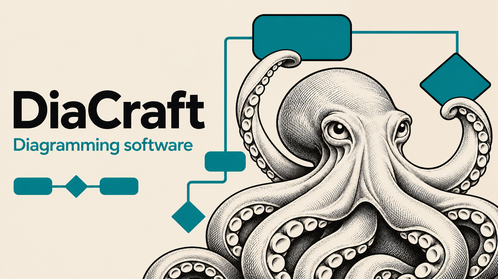

# DiaCraft

DiaCraft is an open-source, pure-Rust diagramming application: stencils and masters, ShapeSheet formulas, smart connectors,
the VSDX file formats, and the diagram formats people commonly use alongside them. It targets macOS, Windows, Linux, FreeBSD
and the web, and everything a person can do can also be driven by an agent through a CLI and an MCP server.

DiaCraft opens and saves Visio drawings, stencils and templates (`.vsdx`, `.vsdm`, `.vssx`, `.vssm`, `.vstx`, `.vstm`),
OpenDocument drawings and templates (`.odg`, `.otg`, `.fodg`) and its own `.diacraft` files, and exports a page as PNG, SVG or PDF.

**Status: pre-alpha.** Foundations are in place: a window laid out like a diagramming app (ribbon, Shapes window, rulers and
grid, page tabs, status bar, File view) that opens on an empty drawing or on a `.vsdx` file or an OpenDocument drawing (`.odg`, `.fodg`) (`diacraft FILE`, or File, Open) and draws every page of it, a command engine, a control channel, a CLI and an MCP
server. It can draw a small diagram by hand (drop shapes from the Shapes window, move and resize them, join them with connectors, type their labels, colour them, set their fonts, turn, flip, align and reorder them) and save it as `.diacraft`, `.vsdx` or `.odg`, and it opens the file again (a drawing that came from a file is saved in that file's format unless another is chosen); many of the window's other controls are drawn and not yet working. DiaCraft's own format, `.diacraft`, has a [public specification](docs/diacraft-format.md), and the engine opens and saves it through the command line, the MCP server and the control channel (a new drawing is a `.diacraft` drawing, which keeps no file's bytes: its first save is `.diacraft`, a Save As to a VSDX type writes it from the model, and a `.vsdx` that was opened is saved as a `.vsdx`; the window's file dialogs offer the format first, and it is the default of the 0.2 release). `diacraft-cli convert FILE --out PATH` writes a drawing as another type by the extension of `PATH` (the engine's own Save As for a drawing type, `.png`, `.svg` or `.pdf` for a picture: [`docs/cli.md`](docs/cli.md)). See [`ROADMAP.md`](ROADMAP.md).
The Shapes gallery uses a compact stencil chooser, a filter for the active stencil and uniform square cards with centered graphite previews and name-only hover tooltips in both light and dark themes. The interface uses neutral surfaces, a quieter grid and regular open interface fonts when available. The app uses its original octopus icon and a matching cover on File Home ([artwork and provenance](docs/branding.md)).

The built-in catalogue contains **seven stencils and 58 masters**: Basic Shapes, Basic Flowchart, Decorative Shapes, Arrow Shapes, basic Gane-Sarson, the Cross-Functional Flowchart Shapes and the Organization Chart Shapes. All fifty-eight masters save and reopen in a `.vsdx`, and in a drawing that came from an `.odg` (they are written there, and read back as the session had them).

To try what exists: `cargo run --release -p diacraft`. The web build (`apps/diacraft-web`) runs the same window in a browser tab: `cargo xtask site --web` builds it with [trunk](https://trunkrs.dev/) into a folder of its own, the root of the app's own site, beside the folder of the website's pages (the module is 17.35 MiB, in three parts of at most 8 MiB where Cloudflare Pages allows a file 25 MiB, and the splash picture, the cover and the licence list are fetched when they are shown), and the site's "Open DiaCraft in your browser" page says what it leaves out. It opens, saves and exports files on the reader's computer (the file chooser or a drop, a download or a write to the file the reader chose) and sends nothing anywhere; it refuses in words a drawing too large for the browser's memory, and has no printer, only a PDF ([`docs/website.md`](docs/website.md), "The web app").

## Install

From the first release (0.2), each version has downloads for Linux, Windows and macOS on the project's GitHub releases page, with a `SHA256SUMS` file to check them against: an installer and an archive for each system, for Intel/AMD (x86_64) and for ARM64 where there is one. Each holds the app (`diacraft`) and the command line tool (`diacraft-cli`), the licences (DiaCraft's own, and those of the libraries it is built from), and an archive has a `README.txt` that says how to start them. **The downloads are not signed in 0.2**, so Windows and macOS ask you to confirm the first time you open the app ([how](docs/releasing.md#opening-an-unsigned-download)).

| System | Download | Needs |
|---|---|---|
| Linux, Intel/AMD (x86_64) and ARM64 | `diacraft-<version>-linux-<arch>.AppImage` (make it executable and run it), `.deb` (`sudo apt install ./file.deb` on Debian and Ubuntu) or `.tar.gz` (unpack it, run `./diacraft`, or run `./install.sh` to add it to your application menu); `<arch>` is `x86_64` or `arm64` | glibc 2.35 or newer on either CPU (Ubuntu 22.04, Debian 12), Wayland or X11, a Vulkan or OpenGL driver |
| Windows, Intel/AMD (x64) and ARM64 | `diacraft-<version>-windows-<arch>.msi`: an installer for you alone, no administrator rights, with a Start menu shortcut, `diacraft-cli` on your `PATH` and DiaCraft in "Open with" for `.diacraft`, `.vsdx` and `.odg`; or `.zip`: unpack it and double-click `diacraft.exe` | Windows 10 or 11, a DirectX 12, Vulkan or OpenGL driver |
| macOS (Apple silicon and Intel) | `diacraft-<version>-macos-universal.dmg`: drag `DiaCraft.app` onto Applications; or `.zip` | macOS 11 or newer |

To build from source instead: `cargo build --release --locked -p diacraft -p diacraft-cli` (Rust 1.100.0 is what CI uses; on Linux the window-system and font development packages that `.github/workflows/ci.yml` lists). `diacraft-cli --version` and `diacraft --version` print the version. How a release is made and signed: [`docs/releasing.md`](docs/releasing.md).

## How it is built

DiaCraft is written from public information only. Nothing from another vendor's program is used (no binaries, stencils,
templates, fonts or help files), and no code under a copyleft licence is copied. The desktop application whose files DiaCraft
opens and saves, which the docs call the reference app, is not run by the project, so **it has not been inspected, and our
output has not been opened in it by the project.** Claims about it stay marked unverified. If you open a DiaCraft file in
it, a public issue saying what happened helps a lot.

The architecture and standards follow the [storytold craft apps](https://github.com/storytold/vectorcraft), and some of
their permissively licensed code is reused with attribution ([`docs/provenance.md`](docs/provenance.md)).

DiaCraft is an independent project. The trademarks it names, and the owners it is not affiliated with or endorsed by, are in
[`NOTICE`](NOTICE).

How to build it, run the checks and send a change: [`CONTRIBUTING.md`](CONTRIBUTING.md).

## License

Code and original assets are licensed under either of [MIT](LICENSE-MIT) or [Apache-2.0](LICENSE-APACHE), at your option.

The libraries DiaCraft is built from have licences of their own, and those licences ask that their notices travel with the programs. They are in
[`THIRD-PARTY-LICENSES.txt`](THIRD-PARTY-LICENSES.txt): every crate the app and the command line are built from on Linux, Windows and macOS, the licence DiaCraft
uses it under, and each licence text. `cargo xtask licenses` makes the file and `cargo xtask licenses --check` keeps it current. Every download carries it
beside [`NOTICE`](NOTICE) and [`ATTRIBUTION.md`](ATTRIBUTION.md) (the fonts and the pictures), and the window shows it under File, About, Third-party licences. The web build has a list of its own, [`THIRD-PARTY-LICENSES-WEB.txt`](THIRD-PARTY-LICENSES-WEB.txt), which the web app's window shows.
